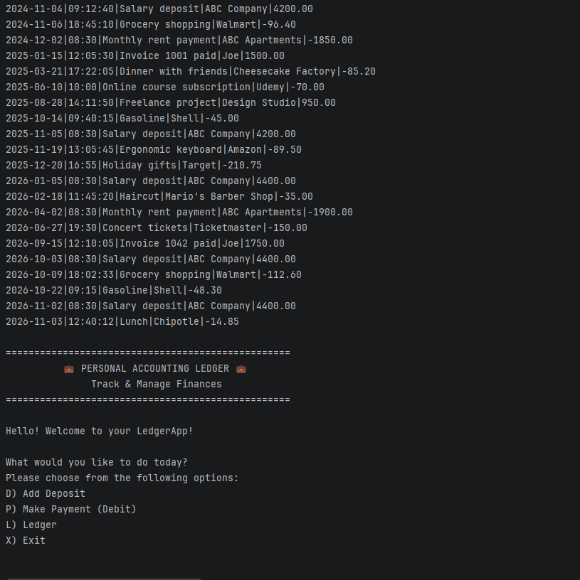
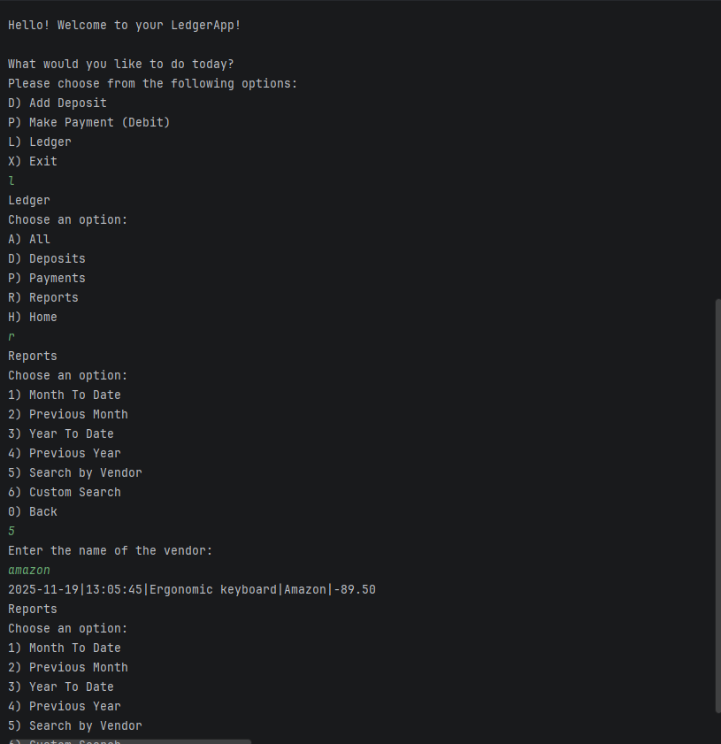
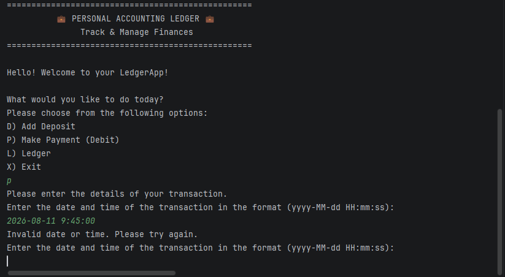
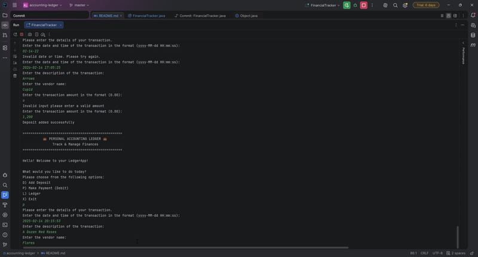

# Accounting Ledger Capstone Project

A ledger app that keeps a record of a user's deposits and payments in a csv file and allows them search it by date,
    vendor, amount and more.

## Description of the Project

This application is a digital ledger meaning it tracks transactions for a user, whether they are a business or a person's
own funds. The user can start off with items in the ledger by downloading the `transactions.csv` file, or create their own
ledger by adding own transactions to it directly. The application is easy to use and makes keeping track of your finances
simple.

## Features

- Add Deposit: Prompt for date/time, description, vendor, and positive amount, saving it to the CSV.
- Make Payment: Prompt for transaction details and store the amount as a negative value.
- Ledger:
  - All: Display all ledger entries sorted newest first.
  - Deposits: Filter and display only positive deposit entries.
  - Payments: Filter and display only negative payment entries.
  - Reports:
    - Date Ranges: Pre-defined reports for Month-to-Date, Previous Month, Year-to-Date, and Previous Year.
    - Vendor Search: Filter and display transactions matching a specific vendor.

## User Stories

- As a user, I would like the ability to view my options so, I know what I can do.
- As a user I would like to be able to make deposits and save them to my ledger, so I can later view them all in one place.
- As a user I would like to record my payments so that I can view and track my expenses.
- As a user I would like to view my ledger so I can see all of my entries in one place.
- As a user I would like to sort my entries by deposits so I can easily find my deposits.
- As a user I would like the ability to see payment entries specifically so that I can view only my expenses.
- As a user I would like the ability to use custom filters when searching my ledger, to make finding specific entries more efficient.
- As a user I would like the ability to return to the home page so that I can access other options or update my ledger if need be.

## Setup

### Prerequisites

- Java 17 (Amazon Corretto), the version used in class.
- IntelliJ IDEA Community Edition: <https://www.jetbrains.com/idea/download/>

### Running the application

1. Clone this repository, or download it as a zip and unzip it.
2. In IntelliJ: File > Open, pick the project folder (the one that holds `pom.xml`), press Open.
3. Wait for IntelliJ to finish indexing (progress bar at the bottom).
4. Open `src/main/java/com/pluralsight/FinancialTracker.java`. <!-- replace YourMainClassName with the class that has main -->
5. Right-click inside the file and choose Run 'FinancialTracker.main()'.

### Data and configuration

Optional: 

- `transactions.csv` file sits at the project root, next to `pom.xml`. The program reads it at start. If not, one will be created.

## Technologies Used

- Java 17
- IntelliJ IDEA

## Demo








## A piece of code I am proud of

```java
        boolean validEntry = false;
        LocalDateTime dateTime = null;
        while(validEntry == false) {
            System.out.println("Enter the date and time of the transaction in the format (yyyy-MM-dd HH:mm:ss):");
            String dateTimeStr = scanner.nextLine().trim();
            try {
                dateTime = LocalDateTime.parse(dateTimeStr, DATETIME_FMT); // same thing
                validEntry = true;
            } catch (DateTimeParseException e) {
                System.out.println("Invalid date or time. Please try again.");
            }
        }
        LocalDate dateOfTran = dateTime.toLocalDate();
        LocalTime timeOfTran = dateTime.toLocalTime();
```
This snippet ensures that the code doesn't crash and instead allows you to try again.
I am  proud of it because I hate when code crashes, also I'm not the best at typing at times and I tend to make little mistakes, but I also
like to test my code. So, I know having the ability to simply retry instead of restarting the whole program and reentering the information, 
is extremely convenient and something I enjoy. On top of that, I'm sure it's convenient to the user as well.

## Future Work

- Custom search (bonus)
- Format the ledger console output into structured alignment columns using `System.out.printf`.

## Resources

- Java YearUp Fall 2026 hub: <https://raymaroun.github.io/yearup-java-fall2026/>
- Visual Hub: https://raymaroun.github.io/yearup-java-fall2026/week-04/index.html#04-date-range-reports
- W3 Schools: https://www.w3schools.com/java

## Author

- **Amanda Charles**
`https://github.com/charlesa-png`

## Thanks


- Thank you to Raymond (Potato Sensei) for helping me with my code and patiently answering all my questions
- Thank you to Tony for helping me understand the Comparator class and how to use it.
- Thank you to you all for your time and attention!
